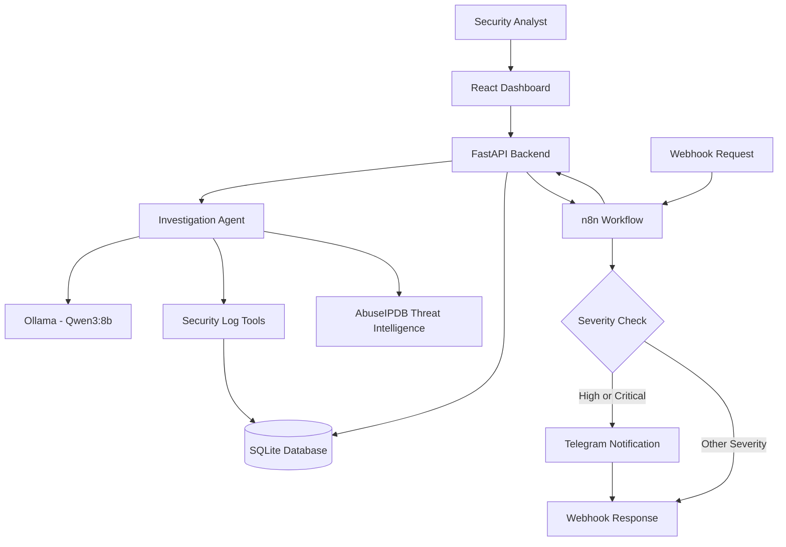

# 🛡️ Sentinel AI — AI-Powered SOC Investigation Agent

Sentinel AI is an AI-assisted Security Operations Center (SOC) investigation platform that helps security analysts investigate alerts, analyze authentication logs, assess risk, and generate structured investigation reports. It combines a local Large Language Model (LLM), deterministic risk scoring, security evidence retrieval, and workflow automation using n8n.

The project is designed to demonstrate how AI agents and automation can support security investigation workflows while keeping findings grounded in retrieved evidence.

## ✨ Key Features

- **AI-Assisted Investigation:** Uses Ollama with the Qwen3:8b model to assist with security investigations and tool selection.
- **Security Log Analysis:** Searches relevant security events, including failed and successful login activity.
- **Risk Assessment:** Calculates risk scores using deterministic rules and assigns severity levels.
- **Evidence-Grounded Reports:** Generates structured investigation reports with findings, evidence, risk explanations, and recommendations.
- **Threat Intelligence:** Supports public IP reputation checks through AbuseIPDB when configured.
- **Investigation History:** Stores investigation records and security evidence in SQLite.
- **Interactive Dashboard:** React-based interface with Investigation, Alert Analysis, and Evidence Repository sections.
- **Workflow Automation with n8n:** Receives investigation requests through a webhook, calls the FastAPI backend, evaluates alert severity, and sends Telegram notifications for qualifying high-severity alerts.
- **Local LLM Execution:** Supports local model inference through Ollama.

## 🏗️ System Architecture



### Investigation Workflow

1. An analyst submits an investigation request or triggers the n8n webhook.
2. The FastAPI backend retrieves alert details and relevant security events.
3. The investigation agent uses predefined tools to gather evidence.
4. Ollama with Qwen3:8b assists with tool selection and investigation reasoning.
5. A deterministic risk engine calculates the risk score and severity.
6. The system produces a structured investigation report and stores the result in SQLite.
7. The n8n workflow evaluates the report severity and sends a Telegram notification when the configured condition is met.
8. The webhook returns the workflow response to the caller.

## 🧰 Technology Stack

| Component | Technology |
|---|---|
| Frontend | React, JavaScript, Vite |
| Backend | Python, FastAPI |
| AI Model Runtime | Ollama |
| Language Model | Qwen3:8b |
| Database | SQLite |
| Workflow Automation | n8n |
| Notifications | Telegram Bot API |
| Threat Intelligence | AbuseIPDB |
| Testing | pytest |
| API Documentation | FastAPI / Swagger UI |

## 📂 Project Structure

```text
sentinel-ai/
├── app/
│   ├── tools/
│   ├── main.py
│   ├── agent.py
│   └── database.py
├── frontend/
│   ├── src/
│   ├── package.json
│   └── ...
├── tests/
├── docs/
├── data/
├── .env.example
├── .gitignore
├── main.py
├── requirements.txt
├── sample-logs.json
├── test_live_agent.py
└── test_report_integration.py
```

*The tree is representative; filenames may differ depending on your current project version. Local databases and environment secrets should not be committed.*

## ⚙️ Prerequisites

Install the following before running the project:

- Python 3.11
- Node.js and npm
- Git
- [Ollama](https://ollama.com/)
- Docker Desktop (for running n8n with Docker)
- A Telegram bot and chat ID if you want Telegram notifications
- An AbuseIPDB API key if you want to enable external IP reputation lookups

## 🚀 Installation and Setup

### 1. Clone the repository

```bash
git clone https://github.com/Ganesh2315049/Sentinel-AI-Agent-.git
cd Sentinel-AI-Agent-
```

### 2. Set up the Python backend

On Windows PowerShell:

```powershell
py -3.11 -m venv .venv
.\.venv\Scripts\Activate.ps1
pip install -r requirements.txt
```

### 3. Start the local AI model

Download the model:

```powershell
ollama pull qwen3:8b
```

Verify that it is available:

```powershell
ollama list
```

Test it:

```powershell
ollama run qwen3:8b
```

Exit the model session with `/bye`. Keep Ollama running when using the AI investigation features.

### 4. Configure environment variables

Create a local `.env` file in the project root. Add only the configuration values required by your implementation.

For example:

```dotenv
ABUSEIPDB_API_KEY=your_abuseipdb_api_key
```

If your n8n workflow uses Telegram credentials, configure the bot token in n8n's credential manager rather than hardcoding it into source code or committing it to GitHub.

Never commit `.env`, API keys, bot tokens, passwords, or other credentials.

### 5. Run the FastAPI backend

From the project root:

```powershell
python -m uvicorn app.main:app --reload --app-dir D:\sentinel-ai
```

Backend URLs:

- Health check: http://127.0.0.1:8000/health
- Swagger API documentation: http://127.0.0.1:8000/docs

Keep this terminal running.

### 6. Run the React frontend

Open a second terminal:

```powershell
cd frontend
npm install
npm run dev
```

Open the frontend at:

http://localhost:5173

## 🔗 API Endpoints

| Method | Endpoint | Purpose |
|---|---|---|
| GET | `/health` | Check backend health |
| POST | `/investigate` | Start an investigation |
| GET | `/investigations` | Retrieve investigation history |
| GET | `/investigations/{history_id}` | Retrieve a specific investigation |
| POST | `/logs/import` | Import security log data |
| GET | `/logs` | Retrieve security logs |
| GET | `/docs` | Open Swagger UI |

### Example investigation request

```http
POST /investigate
Content-Type: application/json
```

```json
{
  "alert_id": "ALT-1001"
}
```

The exact response fields depend on the current API implementation. Investigation results include structured findings, evidence, risk information, and recommendations.

## 🔄 n8n Workflow Automation

Sentinel AI integrates with n8n to automate the investigation workflow.


### Workflow components

1. **Webhook:** Receives a POST request containing an alert ID.
2. **HTTP Request:** Sends the request to the Sentinel AI FastAPI backend.
3. **IF Node:** Evaluates the returned severity against the configured condition.
4. **Telegram Node:** Sends a notification when the condition matches, such as a High or Critical alert.
5. **Respond to Webhook:** Returns the workflow response to the original caller.

### Start n8n with Docker

Start Docker Desktop, then run:

```powershell
docker volume create n8n_data
```

If the container does not already exist:

```powershell
docker run -d --name n8n --restart unless-stopped -p 5678:5678 -e GENERIC_TIMEZONE=Asia/Kolkata -e TZ=Asia/Kolkata -v n8n_data:/home/node/.n8n docker.n8n.io/n8nio/n8n
```

If the container already exists but is stopped:

```powershell
docker start n8n
```

Open n8n:

http://localhost:5678

Complete the initial owner account setup or sign in with your existing account.

### Configure the workflow

Configure the Webhook node with:

- HTTP method: `POST`
- Path: `sentinel-investigate`
- Response mode: use the **Respond to Webhook** node

Configure the HTTP Request node:

- Method: `POST`
- URL: `http://host.docker.internal:8000/investigate`
- Send JSON body:

```json
{
  "alert_id": "ALT-1001"
}
```

The example above uses a fixed test alert. You can configure the webhook and HTTP Request nodes to pass a dynamic alert ID from the incoming request.

**Important:** When n8n runs inside Docker and FastAPI runs directly on Windows, use `host.docker.internal` to reach the host backend from the container.

### Test the production webhook

Activate the workflow in n8n, then run this from PowerShell:

```powershell
$body = @{
    alert_id = "ALT-1001"
} | ConvertTo-Json

Invoke-RestMethod `
    -Method POST `
    -Uri "http://localhost:5678/webhook/sentinel-investigate" `
    -ContentType "application/json" `
    -Body $body
```

Make sure FastAPI and Ollama are available before testing the full investigation.

### Telegram notifications

Configure Telegram credentials in n8n using your bot token. Set the recipient chat ID and map the message to fields returned by the HTTP Request node.

Keep the Telegram node on the intended IF output so notifications are sent only when the configured severity condition matches. Verify both branches and the webhook response before relying on the workflow.


## 🧪 Testing

Activate the Python virtual environment and run:

```powershell
pytest -q
```

To test the live agent separately, use the project's live test script only when Ollama and the required model are available:

```powershell
python test_live_agent.py
```

Live-model and external threat-intelligence tests may depend on local services, credentials, and network access.

## 🔐 Security Considerations

- Treat model output as assistance, not a substitute for analyst validation.
- Base findings on retrieved evidence and distinguish confirmed events from hypotheses.
- Keep API keys and Telegram credentials outside source control.
- Use synthetic or sanitized logs for public demonstrations.
- Restrict access to the n8n editor and protect exposed webhook endpoints before deployment.
- Review notification content to avoid sending sensitive log data to unauthorized recipients.
- Validate and authorize requests before using the application in a real SOC environment.

## 🎯 Project Goals

Sentinel AI demonstrates how AI-assisted reasoning, security log retrieval, deterministic risk assessment, structured reporting, and workflow automation can be combined in a SOC investigation application.

The project is intended as a learning and demonstration platform. Production deployment would require additional authentication, authorization, monitoring, deployment hardening, and security validation.


